# Praktikum 7: Animasi Kompleks & Hierarchical Scene 3D (Three.js)

## Data Mahasiswa
| Nama | NRP |
| :--- | :--- |
| **Maleka Ghaniya** | 5025241189 |
| **Jahhaza Assiqooyah Nurul Hidayah** | 5025241019 |

---

## Judul Prototype
**Interactive Web 3D Prototype — Hierarchical Scene Graph, PBR Materials, GLB Animation, Raycasting Selection & Image-Based Lighting**

---

## Deskripsi Aplikasi
Aplikasi ini merupakan prototype interaktif 3D berbasis web menggunakan **Three.js** dan bundler **Vite** yang mengintegrasikan konsep tingkat lanjut dalam grafika komputer 3D:
1. **Hierarchical Scene Graph & Kinematika Relatif:** Pengorganisasian node parent-child pada sistem tata surya (Sun $\rightarrow$ Earth Orbit $\rightarrow$ Earth $\rightarrow$ Moon Orbit $\rightarrow$ Moon) serta grup transformasi objek bersarang.
2. **Physically Based Rendering (PBR):** Galeri matriks 3x3 bola material PBR (Cook-Torrance BRDF) dengan parameter `roughness` (0.1, 0.5, 0.9) dan `metalness` (1.0, 0.5, 0.0), bola cermin kromium, dan material refraksi optik *physical transmission* (kaca amethyst).
3. **Impor Model 3D glTF/GLB & AnimationMixer:** Pemuatan model `Duck.glb` dengan normalisasi bounding box otomatis, traversal hierarki node, dan manajemen multi-klip animasi (*Idle*, *Walk*, *Run*) dengan *crossfading* halus.
4. **Interaksi 3D Raycasting & State Management:** Konversi kursor layar ke *Normalized Device Coordinates* (NDC), deteksi benturan raycast, umpan balik hover emissive non-destruktif, dan seleksi objek dengan auto-rotasi berbasis *delta time*.
5. **Image-Based Lighting (IBL) & HDR Environment:** Pencahayaan fotorealistik berbasis tekstur panorama equirectangular 360° yang diproses melalui *PMREMGenerator*, dengan kontrol independen antara latar belakang visual (`scene.background`) dan refleksi material (`scene.environment`).
6. **Post-Processing & Responsive Viewport:** Efek pendaran cahaya *UnrealBloomPass*, tonemapping ACESFilmic, kontrol kamera *OrbitControls*, serta proyeksi kamera ganda (*Perspective* & *Orthographic*).

---

## Kontrol & Pintasan Keyboard
| Tombol / Aksi | Fungsi | Challenge Terkait |
| :--- | :--- | :--- |
| **`1`** | Beralih ke **Clip 1 (Idle)** dengan crossfade | **Challenge A** |
| **`2`** | Beralih ke **Clip 2 (Walk)** dengan crossfade | **Challenge A** |
| **`3`** | Beralih ke **Clip 3 (Run)** dengan crossfade | **Challenge A** |
| **`Click` pada Duck** | Memilih bebek & memicu animasi berikutnya | **Challenge B** |
| **`Click` pada Objek** | Menampilkan detail objek di Information Panel | **Challenge C** |
| **`Click` pada Objek** | Mengaktifkan rotasi perlahan berkelanjutan | **Challenge G** |
| **`Click` Area Kosong** | Deselect objek & menghentikan rotasi tambahan | **Challenge G** |
| **`Hover` Kursor** | Highlight emissive keemasan + skala $1.06\times$ | **Challenge F** |
| **`E`** | Toggle Refleksi Environment (ON / OFF) | **Challenge H** |
| **`P`** | Toggle Background Panorama Skybox (ON / OFF) | **Fitur IBL** |
| **`S`** | Pause / Resume simulasi orbit Tata Surya | **Challenge D** |
| **`R`** | Reset seluruh posisi kamera & scene | **Utilitas** |
| **Drag Kiri** | Orbit / rotasi sudut pandang kamera | OrbitControls |
| **Drag Kanan** | Pan / pergeseran posisi target kamera | OrbitControls |
| **Scroll Roda** | Zoom in / zoom out kamera | OrbitControls |

---

## Struktur Scene Graph

### Diagram Arsitektur Hierarki (Mermaid)

```mermaid
graph TD
    Scene["Scene (Root World)"]
    
    %% Pencahayaan
    Scene --> HemiLight["HemisphereLight (Ambient Biru-Ungu)"]
    Scene --> KeyLight["DirectionalLight (Key Shadow Caster)"]
    Scene --> PointLight1["PointLight (Cyan Neon)"]
    Scene --> PointLight2["PointLight (Magenta Neon)"]
    Scene --> Ground["Ground Plane (MeshStandardMaterial)"]
    Scene --> StarField["StarField (Points Particle System)"]
    
    %% Hierarchical Group 1
    Scene --> HierarchyGroup["Hierarchy Parent Group (Rotasi Y)"]
    HierarchyGroup --> ParentMesh["Parent Mesh (Amethyst Glass Cube)"]
    HierarchyGroup --> ChildMesh["Child Mesh (Emerald Neon Sphere, Local Offset)"]
    ChildMesh --> ChildLight["PointLight (Emerald)"]
    
    %% Hierarchical Group 2: Solar System (Challenge D)
    Scene --> SolarSystem["Solar System Group (Challenge D)"]
    SolarSystem --> Sun["Cyber Sun (Mesh + PointLight)"]
    SolarSystem --> EarthOrbit["Earth Orbit Group (Rotasi Orbit Bumi)"]
    EarthOrbit --> EarthPath["Earth Orbit Ring Guide"]
    EarthOrbit --> Earth["Cyber Earth (Mesh Cyan, Local X = 2.0)"]
    Earth --> MoonOrbitPath["Moon Orbit Ring Guide"]
    Earth --> MoonOrbit["Moon Orbit Group (Pusat di Bumi)"]
    MoonOrbit --> Moon["Cyber Moon (Mesh Platinum, Local X = 0.65)"]
    
    %% PBR Gallery (Challenge E)
    Scene --> Gallery["PBR Material Gallery (Group 3x3 Grid)"]
    Gallery --> S1["PBR r0.1 m1.0"]
    Gallery --> S2["PBR r0.5 m1.0"]
    Gallery --> S3["PBR r0.9 m1.0"]
    Gallery --> S4["PBR r0.1 m0.5"]
    Gallery --> S5["PBR r0.5 m0.5"]
    Gallery --> S6["PBR r0.9 m0.5"]
    Gallery --> S7["PBR r0.1 m0.0"]
    Gallery --> S8["PBR r0.5 m0.0"]
    Gallery --> S9["PBR r0.9 m0.0"]
    
    Scene --> ChromeSphere["Rose-Gold Sphere (Pure Mirror Reflection)"]
    
    %% Imported Model (Challenge A, B, C)
    Scene --> GLBRoot["Imported Duck GLB (gltf.scene)"]
    GLBRoot --> DuckMesh["Duck Sub-Meshes (MeshStandardMaterial)"]
```


### Pohon Node ASCII
```text
Scene
├── HemisphereLight
├── DirectionalLight (Key Light - Cast Shadow)
├── PointLight Cyan (-5, 3, 2)
├── PointLight Magenta (5, 3, 2)
├── Ground (CircleGeometry, Receive Shadow)
├── StarField (1200 Points, Vertex Colors)
├── Rose-Gold Mirror Sphere (metalness: 1.0, roughness: 0.02)
├── Hierarchy Parent Group (position: 3.4, 1.2, 0)
│   ├── Parent Mesh - Amethyst Glass (BoxGeometry, Physical Transmission: 0.96)
│   └── Child Mesh - Emerald Neon (SphereGeometry, position: 0.9, 0.8, 0)
│       └── PointLight Emerald
├── Solar System (position: -3.2, 0, 0) [Challenge D]
│   ├── Sun (SphereGeometry, Emissive Magenta + PointLight)
│   └── Earth Orbit (Group di pusat Matahari, rotasi orbit Bumi)
│       ├── Earth Orbit Path (LineLoop Ring Guide)
│       └── Earth (SphereGeometry Cyan, position: 2.0, 0, 0)
│           ├── Moon Orbit Path (LineLoop Ring Guide)
│           └── Moon Orbit (Group di pusat Bumi, rotasi orbit Bulan)
│               └── Moon (SphereGeometry Platinum, position: 0.65, 0, 0)
├── PBR Material Gallery (Group) [Challenge E]
│   ├── Row 1 (Metalness 1.0): Sphere r0.1 | Sphere r0.5 | Sphere r0.9
│   ├── Row 2 (Metalness 0.5): Sphere r0.1 | Sphere r0.5 | Sphere r0.9
│   └── Row 3 (Metalness 0.0): Sphere r0.1 | Sphere r0.5 | Sphere r0.9
└── Imported Duck GLB (gltf.scene, Bounding-Box Fitted) [Challenge A, B, C]
    └── Duck Mesh Node Tree (Cloned Materials, Cast Shadow)
```

---

## Model & Sumber Asset
1. **Model 3D GLB:**
   - **Nama File:** `Duck.glb`
   - **Penyedia/Lisensi:** Khronos Group glTF Sample Models (Public Domain / CC0).
   - **Struktur:** Format biner GLB yang berisi node mesh, buffer vertex koordinat, normal, UV mapping, dan material dielektrik.
2. **Tekstur HDR Panorama (Equirectangular Radiance Maps):**
   - **Moonless Golf Night 1K (`moonless_golf_1k.hdr`):** Tiga dimensi langit malam dengan pencahayaan bintang alami (Poly Haven / Three.js Examples).
   - **Studio Small 09 1K (`studio_small_09_1k.hdr`):** Lingkungan pencahayaan studio dengan softbox kontras tinggi (Poly Haven).
   - **Ladybrand Heritage House 1K (`ladybrand_heritage_house_1k.hdr`):** Interior arsitektur klasik dengan jendela dinamis (Poly Haven).
   - **Cosmic Nebula & Stars:** Tekstur panorama luar angkasa prosedural berbasis HTML5 Canvas 2D linear-radial gradient.
   - **Procedural Cyberpunk Gradient:** Tekstur garis pendar neon vertikal prosedural.

---

## Implementasi Challenge

### 92. Challenge A — Multiple Animation Clips
- **Deskripsi:** Mengelola multi-klip animasi (*Idle*, *Walk*, *Run*) pada satu model imported menggunakan satu `AnimationMixer` tunggal.
- **Implementasi:**
  - File `Duck.glb` tidak memiliki animasi bawaan secara internal, sehingga sistem menginisialisasi 3 klip prosedural yang sangat distingtif menggunakan `THREE.AnimationClip` dan `THREE.NumberKeyframeTrack`:
    - **Clip 1 (`1 · Idle`):** Animasi mengangguk halus (*subtle head nod*) dan bernapas (*bobbing Y*) berdurasi 2.0 detik.
    - **Clip 2 (`2 · Walk`):** Animasi langkah bebek goyang ke kiri dan kanan (*waddling roll Z*) dengan rotasi Y berirama berdurasi 1.0 detik.
    - **Clip 3 (`3 · Run`):** Animasi sprint cepat berenergi tinggi dengan pantulan Y tinggi dan rotasi X-Z agresif berdurasi 0.45 detik.
  - Setiap klip diikat menjadi `AnimationAction` via `state.mixer.clipAction(clip)`.
  - Fungsi `playClip(index)` menerapkan **Crossfading**: aksi aktif sebelumnya dipudarkan secara halus menggunakan `fadeOut(0.25)`, sedangkan aksi baru diatur ulang dan dimunculkan menggunakan `reset().fadeIn(0.25).play()`.
  - Shortcut keyboard **`1`**, **`2`**, **`3`** dan tombol interaktif UI disinkronkan langsung ke status pemutaran animasi.

### 93. Challenge B — Click Menjalankan Animasi
- **Deskripsi:** Ketika imported model diklik di kanvas, alur eksekusi `Click → Select → Play animation` langsung dijalankan.
- **Implementasi:**
  - Event listener `click` pada kanvas menembakkan raycast ke koordinat mouse NDC.
  - Fungsi `isDescendantOf(hit.object, state.gltfRoot)` mendeteksi apakah sub-mesh yang terbentur merupakan bagian dari model bebek.
  - Jika ya:
    1. Objek bebek dipilih (`state.selected = state.gltfRoot`).
    2. Feedback visual diterapkan (skala membesar $1.12\times$ dan warna emissive keemasan).
    3. Indeks klip dimajukan secara siklis (`state.clipIndex = (state.clipIndex + 1) % clips.length`).
    4. Fungsi `playClip(state.clipIndex)` dipanggil seketika untuk memainkan animasi baru dengan crossfade.

### 94. Challenge C — Information Panel
- **Deskripsi:** Menampilkan parameter spasial dan material objek yang dipilih secara real-time pada panel HUD: Name, Position (Local & World), Rotation, Scale, dan Material Type. Jika objek merupakan model impor, tampilkan label root.
- **Implementasi:**
  - Fungsi `updateInfo(object)` mengekstraksi koordinat lokal `object.position`, `object.rotation`, dan `object.scale`.
  - Koordinat dunia absolut diekstraksi menggunakan `object.getWorldPosition(world)`.
  - Sudut rotasi radian dikonversi ke derajat busur $(\times 57.3^\circ)$ agar informatif bagi pengguna.
  - Tipe material ditampilkan lengkap dengan parameter roughness dan metalness jika berupa `MeshStandardMaterial`.
  - Jika objek adalah model GLB, elemen badge `#infoRootBadge` ditampilkan: `Root Model: Imported Duck GLB`.

### 95. Challenge D — Hierarchical Solar System
- **Deskripsi:** Membangun struktur tata surya hierarkis bertingkat tanpa menghitung koordinat dunia manual:
  ```text
  Sun
  └── Earth Orbit (Group di pusat Matahari)
      └── Earth (Mesh di radius X = 2.0)
          └── Moon Orbit (Group di pusat Bumi)
              └── Moon (Mesh di radius X = 0.65)
  ```
- **Implementasi:**
  - Grup `moonOrbit` dimasukkan sebagai child langsung dari mesh `earth` (`earth.add(moonOrbit)`).
  - Objek `earth` dimasukkan sebagai child dari grup `earthOrbit` (`earthOrbit.add(earth)`).
  - Grup `earthOrbit` dimasukkan bersama `sun` ke dalam grup `solarSystem`.
  - Pada render loop:
    ```javascript
    earthOrbit.rotation.y += delta * state.orbitSpeed; // Revolusi Bumi mengitari Matahari
    earth.rotation.y += delta * 1.5;                  // Rotasi aksial poros Bumi
    moonOrbit.rotation.y += delta * 3.5;              // Revolusi Bulan mengitari Bumi
    moon.rotation.y += delta * 2.0;                   // Rotasi aksial poros Bulan
    sun.rotation.y += delta * 0.2;                    // Rotasi aksial poros Matahari
    ```
  - Posisi Bulan di ruang dunia secara otomatis dihitung oleh GPU melalui perkalian rantai matriks tanpa membutuhkan satu pun rumus trigonometri manual di sisi CPU.
  - Lintasan orbit neon divisualisasikan menggunakan `THREE.LineLoop`. Tombol **`S`** dapat digunakan untuk pause/resume orbit.

### 96. Challenge E — PBR Material Gallery
- **Deskripsi:** Membangun galeri matriks 3x3 bola PBR dengan sumbu horizontal `roughness` (0.1, 0.5, 0.9) dan sumbu vertikal `metalness` (1.0, 0.5, 0.0).
- **Implementasi:**
  - Rangkaian bola diatur pada koordinat kisi $(X, Y, Z)$ melengkung lembut di latar scene.
  - Setiap bola mempertahankan nilai parameter PBR tetap untuk tujuan komparasi visual:
    - **Kolom 1 ($r: 0.1$):** Pantulan cermin lingkungan jernih, highlight spekular tajam.
    - **Kolom 2 ($r: 0.5$):** Pantulan semi-gloss lembut, highlight menengah.
    - **Kolom 3 ($r: 0.9$):** Pantulan difus kasar/matte, highlight lebar tanpa detail cermin.
    - **Baris 1 ($m: 1.0$):** Karakteristik logam murni (konduktor), albedo diffuse nol, pantulan spekular berwarna.
    - **Baris 2 ($m: 0.5$):** Karakteristik semi-logam.
    - **Baris 3 ($m: 0.0$):** Karakteristik dielektrik/non-logam (keramik/plastik/karet), albedo diffuse dominan dengan highlight spekular putih netral.
  - Setiap bola dapat diklik untuk diinspeksi nilainya secara mandiri pada Information Panel.
  - Slider kontrol di aside panel berfungsi sebagai *live inspector* untuk menyesuaikan nilai roughness dan metalness pada objek yang sedang aktif dipilih.

### 97. Challenge F — Hover Emissive (Non-Destruktif)
- **Deskripsi:** Mengubah warna emissive objek saat kursor mouse melintas (hover) tanpa memodifikasi material asli secara destruktif jika material digunakan bersama oleh beberapa mesh.
- **Implementasi:**
  - Saat aset GLB dimuat, setiap mesh menjalankan `mesh.material = mesh.material.clone()` untuk mengisolasi referensi instans material antar sub-mesh.
  - Fungsi `setEmissive(object, enabled)` mengecek apakah objek memiliki properti `emissive`.
  - Jika belum ada di cache, warna asli dan intensitas asli disimpan secara aman di dalam `material.userData.originalEmissive` dan `material.userData.originalEmissiveIntensity`.
  - Saat hover aktif: `material.emissive.set("#d88945")` dengan intensitas 0.75 dan pembesaran skala halus $1.06\times$.
  - Saat kursor pergi (*pointerleave*): warna dan intensitas dikembalikan persis ke nilai aslinya dari `userData`, sehingga integritas material tetap terjaga 100%.

### 98. Challenge G — Selection Rotation
- **Deskripsi:** Saat sebuah objek berstatus dipilih (*selected*), objek tersebut berputar perlahan pada sumbu vertikalnya menggunakan *delta time*. Saat deselect, rotasi tambahan seketika berhenti.
- **Implementasi:**
  - Variabel `state.selected` menyimpan referensi simpul objek yang sedang aktif dipilih via raycasting klik.
  - Di dalam loop `animate()`:
    ```javascript
    if (state.selected) {
      state.selected.rotation.y += delta * 0.8; // 0.8 rad/s (~45.8 deg/s)
    }
    ```
  - Penggunaan `delta` dari `THREE.Clock` menjamin kecepatan rotasi independen dari frame-rate monitor.
  - Saat pengguna mengklik area kosong kanvas, `raycast(event)` menghasilkan `null`, `state.selected` dikosongkan, umpan balik visual dinormalkan, dan rotasi otomatis berhenti seketika.

### 99. Challenge H — Environment Toggle
- **Deskripsi:** Menambahkan tombol shortcut **`E`** dan tombol UI untuk toggle Image-Based Lighting (`Environment: ON / OFF`) guna membandingkan respons fisik material PBR.
- **Implementasi:**
  - Fungsi `toggleEnvironment()` membalik nilai boolean `state.environment`.
  - Di dalam `applyEnvironment()`:
    ```javascript
    scene.environment = state.environment ? environmentTexture : null;
    scene.background = state.panorama ? panoramaTexture : new THREE.Color("#020812");
    ```
  - HUD memperbarui status indikator: `Environment: ON` atau `Environment: OFF`.
  - **Efek Komparasi:**
    - Saat **ON**: Seluruh material PBR (logam, cermin rose-gold, kubus kaca amethyst, dan galeri bola) memantulkan citra panorama HDR 360° secara fotorealistik dengan pencahayaan ambien kaya.
    - Saat **OFF**: Pantulan lingkungan IBL diputus total. Permukaan logam chrome menjadi gelap/hitam pekat karena hanya merespons pantulan titik langsung dari *DirectionalLight*, membuktikan ketergantungan material logam terhadap *Radiance Environment Map*.

---

## Jawaban Lengkap Pertanyaan Analisis 112

### A — Hierarchy
> **Pertanyaan:** Sebuah wheel adalah child dari car. Jika car bergerak 10 unit, apakah local position wheel harus diubah? Jelaskan.

**Jawaban: TIDAK.** Nilai `local position` dari wheel tidak perlu diubah sama sekali.

**Penjelasan:**
Dalam arsitektur *Scene Graph*, setiap node menyimpan transformasi lokal (*Local Transform*) yang didefinisikan relatif terhadap sistem koordinat parent-nya. Hubungan koordinat dunia (*World Space*) dihitung melalui perkalian matriks secara berantai:
$$M_{\text{world}}(\text{wheel}) = M_{\text{world}}(\text{car}) \times M_{\text{local}}(\text{wheel})$$
Ketika mobil bergerak sejauh 10 unit, hanya nilai translasi pada `car.position` yang berubah, yang memperbarui matriks $M_{\text{world}}(\text{car})$. Karena $M_{\text{local}}(\text{wheel})$ bernilai tetap (misalnya offset roda $[1.2, -0.4, 1.8]$ dari bodi mobil), hasil perkalian matriks otomatis menggeser roda sejauh 10 unit di ruang dunia. Inilah keuntungan utama pewarisan transformasi (*transform inheritance*).

---

### B — Scene Graph
> **Pertanyaan:** Mengapa object kompleks seperti robot atau kendaraan lebih mudah dikelola menggunakan hierarchy daripada semua part langsung menjadi child Scene?

**Jawaban: Karena prinsip Pewarisan Transformasi Relatif dan Pemisahan Kinematika Sendi.**

**Penjelasan:**
1. **Peniadaan Perhitungan Manual yang Redundan:** Jika 50 komponen robot (bahu, siku, pergelangan, jari-jemari, baut) dijadikan child langsung dari `Scene`, maka setiap kali robot melangkah maju atau berputar haluan, pengembang harus menghitung ulang koordinat dunia 3D setiap komponen secara manual menggunakan trigonometri matriks yang sangat kompleks dan rentan kesalahan.
2. **Artikulasi Kinematika Lokal:** Dengan hierarki bertingkat (`Bahu → Lengan Atas → Lengan Bawah → Telapak Tangan`):
   - Memutar siku hanya membutuhkan satu baris perintah rotasi pada sumbu lokal siku. Lengan bawah dan telapak tangan otomatis ikut berputar mengikuti orientasi siku tanpa memengaruhi posisi bahu.
3. **Kemudahan Manipulasi Skala Global:** Seluruh tubuh robot dapat dipindahkan, diputar, atau diskalakan secara menyeluruh hanya dengan memanipulasi satu node root induk (`robotGroup.position.set(...)`).

---

### C — PBR
> **Pertanyaan:** Dua sphere mempunyai color sama, tetapi roughness dan metalness berbeda. Mengapa keduanya dapat terlihat sangat berbeda?

**Jawaban: Karena metalness dan roughness mengontrol parameter fisika yang berbeda secara fundamental dalam persamaan Cook-Torrance BRDF (Bidirectional Reflectance Distribution Function).**

**Penjelasan:**
Meskipun nilai warna albedo dasar identik:
1. **Metalness (Konduktivitas Listrik & Tipe Material):**
   - **Dielektrik ($m = 0$):** Memiliki pantulan difus (*diffuse albedo*) yang sangat dominan. Warna dasar terlihat jelas di bawah cahaya lampu. Pantulan spekularnya kecil ($\approx 4\%$ Fresnel $F_0$) dan selalu memantulkan warna cahaya lampu secara netral (putih).
   - **Logam/Konduktor ($m = 1$):** Tidak memiliki pantulan difus sama sekali karena elektron bebas di dalam konduktor menyerap foton yang masuk dan memantulkannya kembali langsung sebagai pantulan spekular. Seluruh warna tampak berasal dari pantulan spekular lingkungan yang diwarnai (*tinted*) oleh warna albedo dasar.
2. **Roughness (Distribusi Mikro-Permukaan / Microfacet Scattering):**
   - **Roughness Rendah ($0.1$):** Permukaan mikro sangat halus dan sejajar sempurna. Cahaya dipantulkan secara terarah dan terfokus, menghasilkan *specular highlight* tajam dan pantulan cermin lingkungan HDR yang sangat jernih.
   - **Roughness Tinggi ($0.9$):** Permukaan mikro sangat acak dan bergelombang. Cahaya dipantulkan menyebar ke segala arah (*scattered*), menghasilkan kilap yang sangat melebar lembut dan pantulan lingkungan yang buram/kabur (*matte*).

Akibatnya, bola logam ber-roughness rendah tampak seperti bola krom cermin mengkilap, sedangkan bola dielektrik ber-roughness tinggi tampak seperti bola kapur/karet kusam tanpa refleksi.

---

### D — Asset
> **Pertanyaan:** Mengapa imported GLB sebaiknya diperlakukan sebagai hierarchy dan bukan diasumsikan hanya satu Mesh?

**Jawaban: Karena format glTF/GLB adalah standar representasi pohon Scene Graph 3D yang lengkap, bukan sekadar berkas geometri tunggal.**

**Penjelasan:**
Sebuah berkas `.glb` umumnya tersusun atas pohon hierarki node yang kompleks:
- Node root wadah koordinat (`gltf.scene`),
- Beberapa sub-mesh independen dengan geometri dan material yang berlainan (misalnya bodi mobil terpisah dari kaca dan ban),
- Matriks transformasi lokal per komponen,
- Rangkaian tulang sendi (*bones/skeleton*) dan bobot pengaruh kulit (*skinning weights*) untuk animasi karakter,
- Kamera dan lampu bawaan dari software pemodelan (Blender/Maya).

Jika diasumsikan sebagai satu Mesh tunggal, properti seperti `.material` atau `.geometry` pada root akan bernilai `undefined`. Penanganan bayangan (`castShadow`/`receiveShadow`), raycasting selection, serta modifikasi material non-destruktif wajib dilakukan melalui penelusuran hierarki menggunakan metode `root.traverse((node) => { if (node.isMesh) ... })`.

---

### E — Animation
> **Pertanyaan:** Mengapa action.play() saja belum cukup tanpa mixer.update(delta) di animation loop?

**Jawaban: Karena `action.play()` hanya menjadwalkan aktivasi klip, sedangkan `mixer.update(delta)` adalah mesin yang menghitung interpolasi matematika keyframe terhadap waktu.**

**Penjelasan:**
Three.js memisahkan secara modular antara status aksi (*action state*) dan pembaruan timeline matematika (*playback timeline*):
- `action.play()` memberitahu `AnimationMixer` bahwa aksi tersebut harus dimasukkan ke dalam daftar aksi aktif yang dijadwalkan untuk dievaluasi.
- `mixer.update(delta)` bertugas memajukan waktu playback internal sebesar $\Delta t$ (delta time), mengevaluasi kurva interpolasi pada `AnimationClip` (posisi, rotasi kuaternion, skala), menghitung pembobotan fading (*crossfade blending*), dan menuliskan nilai transformasi baru langsung ke matriks node 3D target.

Tanpa pemanggilan `mixer.update(delta)` secara kontinu di dalam `requestAnimationFrame`, waktu timeline mixer membeku di detik ke-0 sehingga model 3D akan tetap diam membeku meskipun `action.play()` telah dipanggil.

---

### F — Raycasting
> **Pertanyaan:** Mengapa coordinate mouse pixel tidak dapat langsung digunakan sebagai coordinate raycaster?

**Jawaban: Karena koordinat piksel mouse berada pada sistem 2D Screen Space, sedangkan kamera 3D Three.js dan Raycaster beroperasi pada Normalized Device Coordinates (NDC) di dalam ruang 3D Clip Space.**

**Penjelasan:**
Perbedaan fundamental kedua ruang koordinat:
- **Screen Space (Mouse):** Satuan berupa piksel nyata layar monitor. Titik origin $(0, 0)$ berada di pojok kiri-atas kanvas HTML. Sumbu X bernilai $[0, \text{lebar}]$ piksel dan sumbu Y mengarah ke bawah $[0, \text{tinggi}]$ piksel.
- **Normalized Device Coordinates (NDC):** Satuan tanpa dimensi (*dimensionless*). Titik origin $(0, 0)$ berada tepat di tengah-tengah kanvas. Sumbu X bernilai $[-1, 1]$ (kiri ke kanan) dan sumbu Y bernilai $[-1, 1]$ (bawah ke atas).

Koordinat piksel mouse wajib dikonversi ke NDC melalui transformasi linear:
$$x_{\text{ndc}} = \left(\frac{x_{\text{pixel}} - \text{rect.left}}{\text{rect.width}}\right) \times 2 - 1$$
$$y_{\text{ndc}} = -\left(\frac{y_{\text{pixel}} - \text{rect.top}}{\text{rect.height}}\right) \times 2 + 1$$

Vektor NDC $(x_{\text{ndc}}, y_{\text{ndc}}, -1)$ kemudian dikalikan dengan *Inverse Projection Matrix* dan *Inverse View Matrix* kamera oleh fungsi `raycaster.setFromCamera()` untuk memproyeksikan garis sinar (ray) 3D dari posisi kamera menembus ruang dunia (*World Space*).

---

### G — Interaction State
> **Pertanyaan:** Mengapa hoveredObject dan selectedObject sebaiknya disimpan pada variabel berbeda?

**Jawaban: Karena hover dan selection merepresentasikan status interaksi (interaction state) dengan durasi hidup (lifecycle) dan semantik interaksi yang berbeda secara mendasar.**

**Penjelasan:**
1. **Hover State (Transient / Sementara):**
   - Aktif hanya selama kursor fisik mouse berada persis di atas poligon objek.
   - Langsung berakhir seketika saat kursor bergeser menjauh (*pointerleave*).
   - Bertujuan memberikan konfirmasi visual instan bahwa objek tersebut dapat diklik (*affordance*).
2. **Selected State (Persistent / Menetap):**
   - Aktif secara permanen setelah aksi klik dikonfirmasi pengguna.
   - Tetap aktif meskipun mouse berpindah posisi untuk mengarahkan kamera atau mengatur slider di panel kontrol.
   - Baru berakhir jika pengguna memilih objek lain atau secara eksplisit mengklik area kosong (*deselect*).

Jika disatukan ke dalam satu variabel, maka efek seleksi (seperti rotasi aktif Challenge G atau inspeksi Information Panel Challenge C) akan langsung terhapus begitu kursor meninggalkan objek, dan pengguna tidak dapat melakukan preview hover pada objek lain saat sebuah objek sedang dianalisis.

---

### H — Environment
> **Pertanyaan:** Mengapa scene.background dan scene.environment dipisahkan walaupun keduanya dapat memakai texture yang sama?

**Jawaban: Karena fungsi grafis keduanya berada pada tahapan pipeline rendering yang berbeda secara fundamental.**

**Penjelasan:**
1. **`scene.background`:**
   - Bertindak murni sebagai latar belakang visual (*visual backdrop* / skybox) yang digambar di belakang seluruh geometri 3D.
   - Tidak memancarkan foton cahaya dan tidak mempengaruhi perhitungan shader material objek 3D sedikit pun.
2. **`scene.environment`:**
   - Bertindak sebagai *Radiance Environment Map* untuk **Image-Based Lighting (IBL)**.
   - Tekstur diproses oleh algoritma PMREM (Prefiltered Mipmapped Radiance Environment Map) untuk menghitung pantulan spekular lingkungan pada material reflektif (logam, kaca) dan pencahayaan ambien tak langsung (*diffuse irradiance*).

Pemisahan ini memberikan kebebasan artistik dan teknis: pengembang dapat menonaktifkan pantulan lingkungan (Challenge H: `scene.environment = null`) untuk menguji bagaimana material merespons hanya lampu terarah, atau menggunakan latar belakang warna gelap netral minimalis (`scene.background = new THREE.Color("#070b18")`) sambil tetap mempertahankan pantulan studio HDR yang kaya pada permukaan objek 3D.

---

## Catatan Debugging & Solusi Teknis
1. **Normalisasi Bounding Box GLB Model:**
   - *Problem:* Model GLB yang diimpor dari perangkat lunak 3D sering kali memiliki skala atau titik origin yang tidak terpusat (terlalu besar atau melayang di bawah lantai).
   - *Solusi:* Dibuat fungsi `fitImportedModel(root)` yang menghitung `THREE.Box3().setFromObject(root)`, menentukan dimensi terbesar, menskalakan model secara otomatis ke target ukuran seragam (1.8 unit), dan menggeser posisi Y agar menapak tepat di atas grid lantai.
2. **Isolasi Material Non-Destruktif (Challenge F):**
   - *Problem:* Ketika beberapa mesh pada model impor berbagi instans material yang sama, mengubah properti `emissive` pada satu mesh akan merusak warna mesh lainnya secara permanen.
   - *Solusi:* Dilakukan kloning material `mesh.material = mesh.material.clone()` saat traversal pemuatan GLB, dan nilai warna asli disimpan di `material.userData.originalEmissive` sebelum modifikasi hover diterapkan.
3. **Pembedaan Gesture Drag vs Click pada OrbitControls:**
   - *Problem:* Saat pengguna melakukan drag orbit kamera dan melepaskan mouse di atas objek, browser memicu event `click` yang tidak disengaja memilih objek tersebut.
   - *Solusi:* Ditambahkan mekanisme pelacak jarak pointer (`hypot(dx, dy) > 5`). Jika perpindahan kursor mouse saat ditekan melebihi 5 piksel, variabel `suppressSelection` diaktifkan untuk membatalkan seleksi raycasting.
4. **Manajemen Memori GPU pada Tekstur HDR:**
   - *Problem:* Mengganti tekstur HDR equirectangular berulang kali dapat menyebabkan kebocoran memori GPU (*WebGL memory leak*).
   - *Solusi:* Setiap kali tekstur baru dipilih, tekstur panorama lama dan target PMREM lama dibuang secara eksplisit menggunakan `panoramaTexture.dispose()` dan `environmentTarget.dispose()`.

---

## Cara Menjalankan

### Menggunakan Node.js & Vite (Rekomendasi)
1. Buka terminal pada direktori `praktikum_7`:
   ```bash
   cd "praktikum_7"
   ```
2. Pasang dependensi project:
   ```bash
   npm install
   ```
3. Jalankan server pengembangan lokal (Dev Server):
   ```bash
   npm run dev
   ```
4. Buka URL yang ditampilkan di terminal pada browser (biasanya `http://localhost:5173/`).

### Menggunakan VS Code Live Server
Buka file `index.html` pada folder `praktikum_7` atau halaman utama repositori `halaman_awal/halaman_praktikum.html`, lalu klik kanan dan pilih **"Open with Live Server"**. Import map CDN Three.js akan memuat pustaka secara langsung.

---

## Checklist Pengujian & Verifikasi
- [x] Project dapat di-install ulang dengan `npm install`.
- [x] `npm run dev` dan `npm run build` berjalan sukses tanpa error.
- [x] Scene 3D tampil dengan responsif di layar.
- [x] Hierarki parent-child bekerja sempurna (Grup Amethyst-Emerald & Tata Surya).
- [x] Konsep transformasi lokal dan dunia dipahami dan ditampilkan di HUD.
- [x] Material PBR (MeshStandardMaterial & MeshPhysicalMaterial) digunakan dengan benar.
- [x] Parameter roughness dan metalness dapat dibandingkan secara visual pada galeri 3x3.
- [x] Berkas `Duck.glb` berhasil dimuat dan divisualisasikan.
- [x] Seluruh hierarki GLB dapat diperiksa melalui traversal.
- [x] Bayangan (`castShadow` dan `receiveShadow`) aktif dan lembut (*PCFSoftShadowMap*).
- [x] Multi-klip animasi (*Idle*, *Walk*, *Run*) berjalan dengan crossfading halus via tombol **`1`**, **`2`**, **`3`** (Challenge A).
- [x] Klik pada model bebek memicu pemutaran klip animasi baru (Challenge B).
- [x] Information Panel menampilkan data lengkap: Name, Position (Local & World), Rotation, Scale, Material, dan Root Label (Challenge C).
- [x] Tata surya hierarkis (Sun $\rightarrow$ Earth Orbit $\rightarrow$ Earth $\rightarrow$ Moon Orbit $\rightarrow$ Moon) berputar tanpa perhitungan posisi manual (Challenge D).
- [x] Galeri matriks 3x3 bola PBR menampilkan hubungan roughness dan metalness secara visual (Challenge E).
- [x] Umpan balik hover emissive bekerja secara non-destruktif dan pulih saat kursor pergi (Challenge F).
- [x] Objek terpilih berputar perlahan menggunakan delta time dan berhenti saat deselect (Challenge G).
- [x] Refleksi environment dapat di-toggle via tombol **`E`** dengan indikator HUD yang sinkron (Challenge H).
- [x] Raycasting bekerja akurat dengan konversi pointer NDC yang tepat.
- [x] Rendering responsif saat resize jendela browser tanpa distorsi rasio aspek.
- [x] Tidak ada error pada Console browser.
- [x] Seluruh 8 Challenge (Challenge A s/d H) terselesaikan secara lengkap.
- [x] Pertanyaan Analisis 112 (A s/d H) dijawab secara mendalam dan komprehensif.
- [x] Dokumentasi README lengkap dan terperinci.
